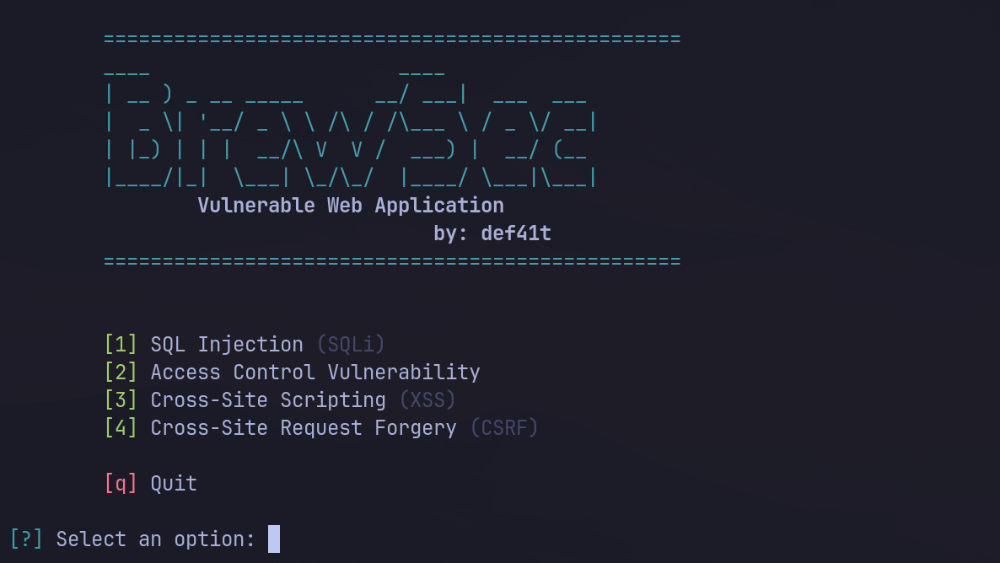

## What Is BrewSec?

**BrewSec** is a deliberately vulnerable web application built for security practice — inspired by **PortSwigger Web Security Academy** but fully open-source and self-hosted, so you can read the vulnerable code *and* exploit it in the same place.

⚠️ **Intentionally insecure. For training and demonstration only. Never deploy to production or expose to the public internet.**

❗It ships with the vulnerable routes, the exploitable code, and the lesson behind each lab — but it does **not** include a flag system or "lab completed" tracking. There are no scores, no solved-state persistence, and no gamified feedback loop. That's intentional. BrewSec is built to **show** how common vulnerabilities look in real Flask code — the kind of thing you'd read in a writeup or point at in a talk — not to run as a scored training platform. You exploit a lab, you see it work, you read the code that made it work. That's the whole loop.It does not include flags and completed messages after solving the lab. So it's demonstration and showcase project only.

## Tech Stack


| Layer        | Technology           | Why                                                                           |
| ------------ | -------------------- | ----------------------------------------------------------------------------- |
| **UI**       | TailwindCSS + Jinja2 | Modern styling with zero build step; Jinja keeps the vulnerable rendering (`  |
| **API**      | Python Flask         | Minimal framework — the buggy line of code is easy to see and easy to change |
| **Database** | SQLite               | Single file, no setup, trivially reset between lab sessions                   |

## Quick Start

```bash
git clone https://github.com/thedef41t/BrewSec--Vulnerable-Web-Application.git
cd BrewSec
python -m venv venv && source venv/bin/activate
pip install -r requirements.txt
python brewsec.py

# -> http://localhost:[lab-port]
```



## Default Credentials

```text
admin:
 - username: administrator
 - password: SecurePass123

user1 (carlos):
 - username: carlos
 - password: CarlosS3c123

user2 (wiener):
 - username: wiener
 - password: SecWiener123
```

## ❗ This is a work in progress.

The menu is intentionally extensible — as more vulnerability classes are added (SSRF, file upload, business logic, information disclosure, and others), they'll appear as new entries here. The current four are the foundation; the roadmap is the full OWASP Top 10 and beyond.

### Why a Menu Instead of a Single Big App

Two reasons:

* **Focus.** Each lab isolates one vulnerability so you're not hunting for the flaw across a sprawling app — you know the class, you know the goal, you go exploit it.
* **Extensibility.** Adding a new lab means adding a menu entry and a route. No restructuring, no breaking existing challenges. The menu is the contract: whatever's listed is what's shipped.

## Secure Verison

The app has secure version which included:

- Proper session validation
- Sanatized login form
- Secure headers
- Password hashing before storing user password

```
# ⚠️ its not completed yet, i'm working on rate_limiting, attack_detector, ip_block, logs and etc.
```

## The `docs/` Folder

The `docs/` folder is where BrewSec's **testing tooling and lab documentation** live — separate from the app itself. Think of it as the "attacker's side" of the project: the app is what you break, and `docs/` is what helps you break it (and record that you did).

It is **actively being built** and most of it is not included yet. What follows is what the folder is *meant* to contain, so anyone joining can understand the plan and pitch in.

## Current Status


| Component                                                           | Location                | Status         |
| ------------------------------------------------------------------- | ----------------------- | -------------- |
| **App**— labs, menu, vulnerable routes                             | `app/`                  | ✅ Working     |
| **Additional vulnerability labs**                                   | `app/`                  | 🚧 Planned     |
| **Exploitation scripts**— one per lab, mirrors the menu (`1`–`4`) | `docs/script.py         | 🚧 Not started |
| **Wordlists**— payloads per lab, one folder per lab                | `docs/<lab>/wordlists/` | 🚧 Not started |
| **Lab reports**— one writeup per level, per lab                    | `docs/<lab>/<level>/`   | 🚧 Not started |

**Legend:** ✅ Working · 🚧 Planned · ⏳ In progress

- **Happy hacking — and welcome to BrewSec.** ☕
