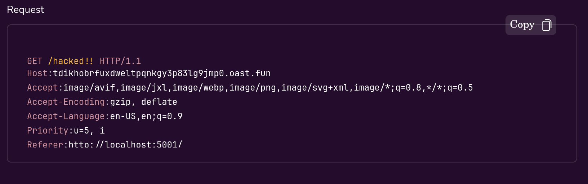

## Cross-Site Scripting ( Basic Reflected XSS ) - Level_01

### **Overview**

This app contains Reflected Cross-Site Scripting vulnerability in review form. It blindly trusts user input without any sanitization. When a user submits a review, the application **directly reflects the submitted input back into the HTTP response** — with no output encoding, sanitization, or validation.

### **Vulnerable code**

```python
def home():
    if request.method == 'POST':
        author = request.form.get('author') # ⚠️ raw input, no validation
        comment = request.form.get('comment') # ⚠️ raw input, no validation
  
        new_review = Review(author=author, comment=comment)
        db.session.add(new_review)
        db.session.commit() # ⚠️ raw payload stored in DB
  
        return redirect(url_for('xss.home'))
  
    reviews = Review.query.order_by(Review.id.desc()).all()
    return render_template('content.html', reviews=reviews)
```

### **POC**

1. Inject a simple javascript code into review form: `<script>alert(1)</script>`
2. Attacker also be able to steal cookies using: ``



- (Interactsh http request)

### **Impact**

Successful exploitation can allow an attacker to steal session cookies, hijack authenticated sessions, perform actions on behalf of the victim, redirect users to malicious sites, or modify the page content.

### **Remedation**

1. Encode all reflected user input according to its output context (HTML, attribute, JavaScript, URL), validate/sanitize input server-side, and enforce a restrictive Content Security Policy (CSP) as defense-in-depth.

```python
import re
from flask import abort

ALLOWED_PATTERN = re.compile(r'^[A-Za-z0-9\s]+$')

def home():
    if request.method == 'POST':
        author  = (request.form.get('author')  or '').strip()
        comment = (request.form.get('comment') or '').strip()

        if not (1 <= len(author) <= 50) or not (1 <= len(comment) <= 1000):
            abort(400, "Invalid input length")

        if not ALLOWED_PATTERN.match(author) or not ALLOWED_PATTERN.match(comment):
            abort(400, "Only letters, numbers, and spaces are allowed")

        db.session.add(Review(author=author, comment=comment))
        db.session.commit()
        return redirect(url_for('xss.home'))

    reviews = Review.query.order_by(Review.id.desc()).all()
    return render_template('content.html', reviews=reviews)
```

2. Do not use `|safe` in templates.

```html

    <p>{{ review.author }}</p>
    <p>{{ review.comment }}</p>

```
